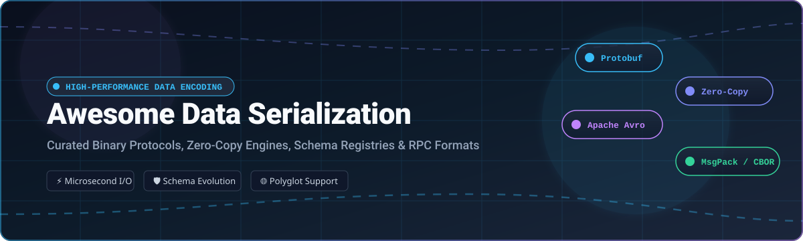

  

# 🚀 Awesome Data Serialization Formats

  
  
  
  
  
  

> ⚡ **A curated list of high-performance data serialization formats, binary encoding protocols, zero-copy engines, RPC frameworks, and managed schema registries for modern distributed systems.**

---

## 📌 Table of Contents

- [🌐 Sector Overview & Market Dynamics](#-sector-overview--market-dynamics)
- [☁️ SaaS / Hosted Schema Registries](#️-saas--hosted-schema-registries)
- [📦 Top Open-Source Serialization Projects](#-top-open-source-serialization-projects)
- [🔍 Architectural Trade-Offs & Comparison](#-architectural-trade-offs--comparison)
- [🤝 How to Contribute](#-how-to-contribute)
- [💖 Support & Sponsorship](#-support--sponsorship)
- [📈 Star History](#-star-history)
- [⚖️ Disclaimer & License](#️-disclaimer--license)

---

## 🌐 Sector Overview & Market Dynamics

The data serialization and event schema management sector is an foundational pillar of the broader **Event Stream Processing (ESP)** and real-time streaming infrastructure market, currently valued at approximately **$2.5 billion to $3.5 billion** and projected to surpass **$10 billion to $12 billion by the early 2030s** at an estimated CAGR of 15%–18%.

The commercial schema registry ecosystem is **moderately concentrated** among hyperscale cloud providers (AWS, Microsoft Azure) and enterprise streaming specialists like Confluent, while the low-level data serialization layer itself is **broadly fragmented and community-driven across specialized open-source standards** (such as Protocol Buffers for RPC microservices, FlatBuffers/Cap'n Proto for zero-copy read pipelines, Avro for Hadoop/Kafka big data, and JSON/TOML for configuration and REST).

---

## ☁️ SaaS / Hosted Schema Registries

The table below catalogs managed cloud schema registry solutions sorted descending by parent company scale (revenue / market valuation).

| Platform | Company Valuation / Revenue Scale | Description | Pricing | Free Tier / Trial Limits |
| :--- | :--- | :--- | :--- | :--- |
| **[Azure Event Hubs Schema Registry](https://azure.microsoft.com/pricing/details/event-hubs/)** | **Microsoft** • Market Cap: **~$3.1 Trillion** • Annual Revenue: **>$245 Billion** | Centralized repository for schema documents in Azure Event Hubs with support for Avro, Protobuf, and JSON schemas. | Included at no extra fee with Event Hubs Standard tier starting at $0.03/hour (~$22.32/month) per Throughput Unit (TU) plus $0.028 per million ingress events. | 30-day free trial via Azure Free Account offering $200 in cloud credits; Standard tier namespace includes up to 25 schema versions across 1 custom schema group (25 MB max registry storage). |
| **[AWS Glue Schema Registry](https://aws.amazon.com/glue/features/schema-registry/)** | **Amazon (AWS)** • Market Cap: **~$1.9 Trillion** • Annual Revenue: **>$570 Billion** | Serverless schema management service integrated with Amazon MSK, Amazon Kinesis, Kafka, and Apache Flink. | $0.00 (included at no additional charge; users only pay for any associated downstream streaming/catalog resources used). | Free forever: Service quota includes up to 100 schema registries and up to 10,000 schema versions per AWS region per account at no charge. |
| **[Confluent Cloud Schema Registry](https://www.confluent.io/confluent-cloud/pricing/)** | **Confluent (IBM)** • Acquisition Valuation: **$11.0 Billion** • Annual Revenue: **$1.17 Billion** | Fully managed Apache Kafka schema registry supporting Avro, Protobuf, and JSON Schema with automated evolution checks. | Stream Governance Essentials tier: $0 base, $0.002 per schema/hour for schemas beyond the included limit; Advanced tier: starts at $1.00/hour (~$730/month) for up to 20,000 schemas. | Free forever tier includes first 100 schemas per environment at $0/month. New signups also get $400 in free Confluent Cloud credits for the first 30 days. |
| **[Buf Schema Registry (BSR)](https://buf.build/pricing)** | **Buf Technologies** • Valuation: **~$350 Million** (Series B) • Total Funding: **$93.4 Million** | Managed registry and governance platform tailored for Protocol Buffers, providing dependency management, code generation, and linting. | Teams tier starts at $0.50 per Protobuf type/month for unlimited private repositories; Pro tier starts at $5.00 per type/month ($3,000/month minimum spend). | Free Community plan includes unlimited public repositories with unlimited types and collaborators, plus 1 private repository capped at 100 Protobuf types. |

---

## 📦 Top Open-Source Serialization Projects

The following active open-source data serialization libraries, binary codecs, and schema engines are **ranked descending by GitHub star count**. Each project includes a real-time social star badge linking directly to its GitHub stargazers.

### 1. **[Protocol Buffers](https://github.com/protocolbuffers/protobuf)** 
- **License**: BSD-3-Clause
- **Ecosystem**: C++, Java, Python, Go, C#, Dart, Kotlin, JavaScript, Ruby, PHP, Objective-C
- **Core Strengths**: Google's industry-standard mechanism for serializing structured data. Delivers extreme compactness and parsing speed with strong backward/forward compatibility and first-class gRPC integration.
- **Best For**: Microservices communication, inter-service gRPC APIs, distributed storage, and mobile-to-backend protocols.

### 2. **[JSON for Modern C++ (nlohmann/json)](https://github.com/nlohmann/json)** 
- **License**: MIT
- **Ecosystem**: Modern C++ (C++11 and higher)
- **Core Strengths**: Header-only, intuitive first-class syntax integration, zero external dependencies, complete test coverage, and strict standard compliance with native binary serialization support (CBOR, MessagePack, UBJSON, BSON).
- **Best For**: Native C++ applications, game development, system utilities, and modern desktop apps.

### 3. **[FlatBuffers](https://github.com/google/flatbuffers)** 
- **License**: Apache-2.0
- **Ecosystem**: C++, C#, C, Go, Java, JavaScript, Kotlin, Rust, Swift, TypeScript, Python
- **Core Strengths**: True **zero-copy** binary serialization format developed by Google. The serialized buffer directly serves as the in-memory representation, bypassing parsing and unpacking entirely for maximum memory efficiency.
- **Best For**: Game engines, embedded systems, graphics pipelines, and real-time simulations where allocation overhead must be zero.

### 4. **[simdjson](https://github.com/simdjson/simdjson)** 
- **License**: Apache-2.0
- **Ecosystem**: C++, with bindings for Go, Python, Rust, C#, Java, Node.js
- **Core Strengths**: Blazing-fast JSON parser parsing gigabytes of JSON per second using single instruction, multiple data (SIMD) CPU instructions (AVX-512, AVX2, ARM Neon).
- **Best For**: High-throughput web API ingestion, big data indexing, log processing, and low-latency financial feeds.

### 5. **[TOML](https://github.com/toml-lang/toml)** 
- **License**: MIT
- **Ecosystem**: Universal (Rust `Cargo.toml`, Python `pyproject.toml`, Go, C++)
- **Core Strengths**: Tom's Obvious, Minimal Language is engineered for human readability and unambiguous mapping to hash tables without YAML's indentation ambiguity.
- **Best For**: Developer tooling configuration files, build systems, application manifests, and service settings.

### 6. **[GJSON](https://github.com/tidwall/gjson)** 
- **License**: MIT
- **Ecosystem**: Go
- **Core Strengths**: Provides an ultra-fast way to retrieve values from JSON documents via single-line path syntax without parsing the entire document into Go structs or memory allocations.
- **Best For**: High-performance Go microservices, event routers, serverless lambdas, and webhook dispatchers.

### 7. **[json-iterator (Go)](https://github.com/json-iterator/go)** 
- **License**: MIT
- **Ecosystem**: Go (and Java version available)
- **Core Strengths**: High-performance 100% drop-in replacement for standard `encoding/json` in Go. Up to 6x faster parsing and encoding without requiring custom struct tags or code generation.
- **Best For**: High-concurrency Go REST backends, API gateways, and web application servers.

### 8. **[Cap'n Proto](https://github.com/capnproto/capnproto)** 
- **License**: MIT
- **Ecosystem**: C++, Rust, Go, Python, JavaScript
- **Core Strengths**: Insanely fast data interchange format and capability-based RPC system with zero-copy deserialization, authored by Kenton Varda (primary author of Protobuf v2).
- **Best For**: Distributed sandboxes (e.g., Cloudflare Workers), sandboxed execution, IPC systems, and capability-secure RPC.

### 9. **[Apache Thrift](https://github.com/apache/thrift)** 
- **License**: Apache-2.0
- **Ecosystem**: 28+ programming languages (C++, Java, Python, Go, Ruby, C#, Erlang, Rust, etc.)
- **Core Strengths**: Comprehensive RPC framework bundling cross-language serialization, protocol abstraction, and scalable transport layers with robust non-atomic schema evolution.
- **Best For**: Enterprise polyglot backend architectures, legacy service meshes, and cross-language microservice fleets.

### 10. **[Serde](https://github.com/serde-rs/serde)** 
- **License**: MIT / Apache-2.0
- **Ecosystem**: Rust
- **Core Strengths**: Generic, macro-based zero-overhead serialization and deserialization framework for Rust. Interfaces natively with JSON, Bincode, Postcard, MessagePack, CBOR, YAML, and TOML.
- **Best For**: All modern Rust applications, high-performance networking, embedded devices, and decentralized protocols.

### 11. **[Go Protobuf (legacy)](https://github.com/golang/protobuf)** 
- **License**: BSD-3-Clause
- **Ecosystem**: Go
- **Core Strengths**: Official Go runtime library and protoc compiler plugin for Protocol Buffers, foundational to cloud-native projects like Kubernetes and Docker.
- **Best For**: Cloud-native Go tooling and historical Protobuf v1 Go implementations.

### 12. **[bup](https://github.com/bup/bup)** 
- **License**: GPL-2.0-only
- **Ecosystem**: Python, C, Git packfile architecture
- **Core Strengths**: Highly efficient backup and deduplication system based on git packfile serialization, splitting enormous virtual machine disk images and data sets into rolling checksum chunks.
- **Best For**: Virtual machine image snapshots, large dataset archiving, and deduplicated storage engines.

### 13. **[Swift Protobuf](https://github.com/apple/swift-protobuf)** 
- **License**: Apache-2.0
- **Ecosystem**: Swift (iOS, iPadOS, macOS, tvOS, watchOS, Linux)
- **Core Strengths**: Apple's official plugin and runtime library for using Protocol Buffers natively in Swift with idiomatic types, Codable compatibility, and efficient memory management.
- **Best For**: iOS mobile apps communicating with gRPC microservice backends.

### 14. **[MessagePack (msgpack-c)](https://github.com/msgpack/msgpack-c)** 
- **License**: BSL-1.0
- **Ecosystem**: C, C++ (with official bindings across 50+ languages)
- **Core Strengths**: "It's like JSON, but fast and small." Encodes compact binary representation without requiring schemas or compilation steps; small integers serialize into a single byte.
- **Best For**: Redis caching payloads, WebSocket real-time feeds, sensor IoT telemetry, and schema-less binary interchange.

### 15. **[Apache Avro](https://github.com/apache/avro)** 
- **License**: Apache-2.0
- **Ecosystem**: Java, Python, C, C++, C#, Go, Rust, Ruby, PHP
- **Core Strengths**: Dynamic typing and premier schema evolution system for big data. The schema is stored alongside the data block, enabling robust schema compatibility checks without mandatory client code generation.
- **Best For**: Apache Kafka event streams, Hadoop/Spark storage formats, and analytical data lake ingestion pipelines.

### 16. **[rust-protobuf](https://github.com/stepancheg/rust-protobuf)** 
- **License**: MIT
- **Ecosystem**: Rust
- **Core Strengths**: Pure-Rust implementation of Google's Protocol Buffers with runtime library support and full protoc code generation plugin capabilities.
- **Best For**: Rust-native gRPC servers and command-line utilities.

### 17. **[Amazon Ion (Java)](https://github.com/amazon-ion/ion-java)** 
- **License**: Apache-2.0
- **Ecosystem**: Java (with C, Python, JavaScript, Go, Rust implementations)
- **Core Strengths**: Amazon's richly-typed, self-describing, hierarchical data serialization format offering interchangeable text and binary representations with built-in symbol tables.
- **Best For**: Internal AWS service communications, document databases (Amazon QLDB), and complex document interchange.

### 18. **[Hprose](https://github.com/hprose/hprose)** 
- **License**: MIT
- **Ecosystem**: Polyglot (JavaScript, Java, Go, PHP, Python, Ruby, C++, Swift, Objective-C, .NET)
- **Core Strengths**: High Performance Remote Object Service Engine featuring seamless object serialization and lightweight cross-language RPC.
- **Best For**: Rapid polyglot microservice communication and web client-to-server RPC.

### 19. **[Jackson Binary Formats](https://github.com/FasterXML/jackson-dataformats-binary)** 
- **License**: Apache-2.0
- **Ecosystem**: Java (JVM)
- **Core Strengths**: Jackson dataformat backends for binary standards including CBOR, Smile, Ion, and Protobuf, enabling JVM apps to switch serialization backends with zero code changes.
- **Best For**: Enterprise Java Spring Boot microservices and Kafka message consumers.

### 20. **[Frugal (CloudWeGo)](https://github.com/cloudwego/frugal)** 
- **License**: Apache-2.0
- **Ecosystem**: Go
- **Core Strengths**: High-performance Thrift serialization library based on JIT runtime code generation, bypassing static reflection and codegen bloat to optimize microsecond latency.
- **Best For**: Ultra-high-throughput Go RPC services in ByteDance/CloudWeGo architectures.

### 21. **[Smile Format Specification](https://github.com/FasterXML/smile-format-specification)** 
- **License**: Apache-2.0
- **Ecosystem**: Specification & reference implementations
- **Core Strengths**: Binary JSON-compatible format that shares JSON's data model 1:1 while offering compact binary encoding, shared key intern pools, and instant parsing.
- **Best For**: Drop-in binary acceleration of existing JSON pipelines.

---

## 🔍 Architectural Trade-Offs & Comparison

| Category | Primary Formats | Key Advantages | Trade-Offs | Ideal Use Cases |
| :--- | :--- | :--- | :--- | :--- |
| **Schema-Driven Binary** | Protocol Buffers, Thrift, Avro | Smallest wire footprint, compile-time type safety, automated schema evolution guarantees | Requires schema compilation (`.proto`, `.thrift`) or schema registry governance | gRPC microservices, event streaming, data pipelines |
| **Zero-Copy Binary** | FlatBuffers, Cap'n Proto | Instant read speed (0 ns unpack), zero heap allocations during traversal | Mutation is complex, rigid buffer construction rules, strict schema constraints | Game engines, high-frequency trading, IoT, embedded systems |
| **Schema-Less Binary** | MessagePack, CBOR, Smile, BSON | Drop-in binary replacement for JSON, compact integer encoding, no code generation | No enforced schema validation at wire layer, slightly larger than schema binary | Caching layers, WebSockets, real-time telemetry, NoSQL databases |
| **Human-Readable Text** | JSON, YAML, TOML, XML | Human inspectable, ubiquitous editor and language support, universal tooling | Higher wire size, CPU-intensive parsing overhead, no native zero-copy | Configuration files, public REST APIs, manifests, browser clients |

---

## 🤝 How to Contribute

We welcome community contributions! To add a new serialization library, format specification, or managed schema service:

1. 🍴 **Fork the repository** on GitHub.
2. 🌿 **Create a descriptive feature branch** (`git checkout -b feature/add-new-format`).
3. 📝 **Add your entry** under the appropriate section following alphabetical or star-ranked order:
   - Include: project name, official GitHub repository link, license, short feature summary, and target use case.
   - For SaaS tools: include verified starting tier pricing and specific free tier limits.
4. 🧪 **Verify all links and markdown formatting**.
5. 🚀 **Submit a Pull Request** with a brief summary of the added technology.

---

## 💖 Support & Sponsorship

If you find this curated collection of data serialization formats useful for your engineering work or distributed systems architecture, please consider supporting the project:

- ⭐ **Star this repository** to help other engineers discover it.
- 🍴 **Fork and contribute** new formats, benchmarks, or updates.
- 📢 **Share** with your engineering team, backend peers, or on social media.
- ☕ **Buy me a coffee / Sponsor**: If you'd like to support ongoing curation and open-source projects, visit the **[Sponsor Dashboard on GitHub](https://github.com/sponsors/ishandutta2007)**.

Thank you for your generous encouragement and support!

---

## 📈 Star History

---

## ⚖️ Disclaimer & License

- This list is **community-curated** for educational, engineering evaluation, and research purposes.
- Serialization formats must always be benchmarked with your specific production payloads and language runtimes, as performance varies significantly across hardware architectures, CPU cache sizes, and memory allocators.
- Released under the [MIT License](LICENSE).
